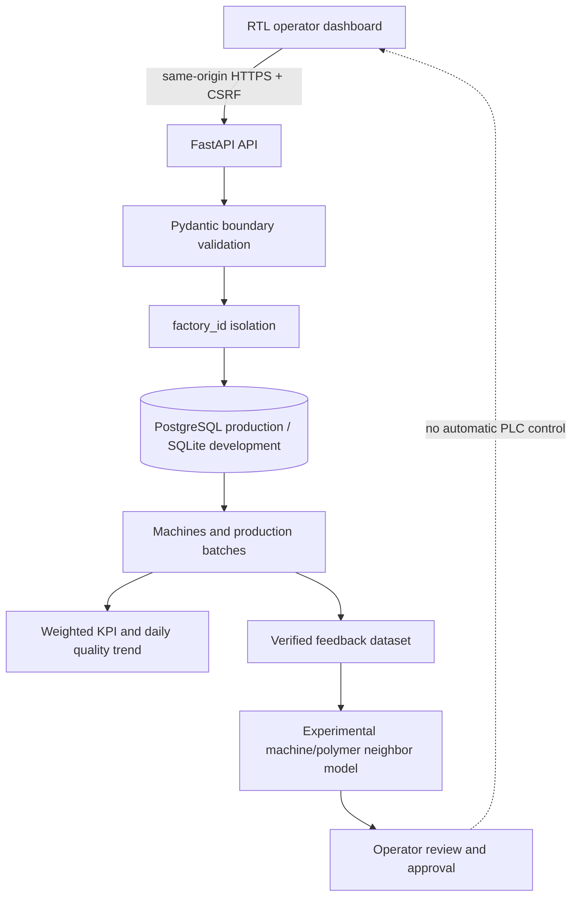

# Granovo architecture

## Runtime components

- `backend/app.py`: API, session/CSRF controls, factory-scoped queries, KPI endpoints, readiness and static mounting.
- `backend/db.py`: SQLAlchemy schema for factories, users, sessions, machines, batches and recommendations.
- `backend/schemas.py`: external input contracts and invariant validation.
- `backend/predictor.py`: deterministic three-neighbor historical estimate with data gate, fingerprint and holdout MAE.
- `landing/dashboard/`: RTL operator workflow for onboarding, batch capture, CSV import, KPI review and recommendation approval.
- `tests/`: SQLite/PostgreSQL API tests and browser-free Node UI tests.

## Data flow

1. A user registers a factory or signs in; the server sets an opaque, hashed session and returns a CSRF token.
2. The operator registers each extruder with its manufacturer-provided limits.
3. A batch records the factory, machine, operator, material summary, actual settings and produced/rejected mass. CSV import is UTF-8, exact-header, max 500 rows/1 MB, and atomic.
4. A reviewer explicitly marks a batch quality-verified. Unverified data cannot train a recommendation.
5. KPI queries use all matching rows and mass-weighted reject rate; history display is capped at 200 rows.
6. After at least eight good verified batches for the same factory/machine/polymer, the experimental predictor estimates settings inside the registered machine limits. It stores a model fingerprint and holdout metrics.
7. Approval re-computes the fingerprint and rejects stale recommendations. Approval is an audit record only; no equipment command exists.

## Operational boundaries

`/health` checks process liveness. `/ready` checks every schema table and returns a generic 503 when the database is unavailable or uninitialized. Production requires HTTPS, a shared rate limiter, backups with retention and recovery drills, role-based access, migration tooling, and monitoring. The local runner never connects to production.
